# HMDG concept patch graph

target: `Module.End.iSup_genEigenspace_restrict_eq_top`
path_length: 10
node_count: 19
edge_count: 32

## Mermaid graph

```mermaid
flowchart LR
    D001["D001\nLinearMap.ker\nDeclaration / kernel"]
    D002["D002\nLinearMap.ker_codRestrict\nDeclaration / kernel"]
    D003["D003\nLinearMap.ker_restrict\nDeclaration / kernel"]
    D004["D004\nLinearMap.injective_restrict_iff_disjoint\nDeclaration / criterion"]
    D005["D005\nLinearMap.comap_eq_sup_ker_of_disjoint\nDeclaration / constraint"]
    D006["D006\nLinearMap.ker_comp_eq_of_commute_of_disjoint_ker\nDeclaration / constraint"]
    D007["D007\nLinearMap.ker_noncommProd_eq_of_supIndep_ker\nDeclaration / constraint"]
    D008["D008\nSubmodule.inf_iSup_genEigenspace\nDeclaration / eigenspace"]
    D009["D009\nSubmodule.eq_iSup_inf_genEigenspace\nDeclaration / eigenspace"]
    D010["D010\nModule.End.iSup_genEigenspace_restrict_eq_top\nDeclaration / eigenspace"]
    C001_kernel_to_criterion{"C001_kernel_to_criterion\nkernel_to_criterion\nConceptBridge / kernel->criterion\ncandidate"}
    C002_criterion_to_constraint{"C002_criterion_to_constraint\ncriterion_to_constraint\nConceptBridge / criterion->constraint\ncandidate"}
    C003_constraint_to_eigenspace{"C003_constraint_to_eigenspace\nconstraint_to_eigenspace\nConceptBridge / constraint->eigenspace\nproof_used_but_over_compressed"}
    C003a(["C003a\niSup_component_extraction\nProofBridge / decomposition\nproof_facing_explanation"])
    C003b(["C003b\nproduct_kernel_isolation\nProofBridge / kernel_product\nproof_facing_explanation"])
    C003c(["C003c\nkernel_independence_to_injectivity\nProofBridge / injectivity\nproof_facing_explanation"])
    C003d(["C003d\ninvariant_submodule_surjectivity_transfer\nProofBridge / transfer\nproof_facing_explanation"])
    C003e(["C003e\ncomponentwise_reassembly\nProofBridge / reassembly\nproof_facing_explanation"])
    C005_ambient_inf_to_restricted_genEigenspace{"C005_ambient_inf_to_restricted_genEigenspace\nambient_intersection_to_restricted_eigenspace\nConceptBridge / eigenspace->eigenspace\nsource_checked"}
    D001 -- main_path_edge --> D002
    D002 -- main_path_edge --> D003
    D003 -- main_path_edge --> D004
    D004 -- main_path_edge --> D005
    D005 -- main_path_edge --> D006
    D006 -- main_path_edge --> D007
    D007 -- main_path_edge --> D008
    D008 -- main_path_edge --> D009
    D009 -- main_path_edge --> D010
    D003 -- needs_bridge --> C001_kernel_to_criterion
    C001_kernel_to_criterion -- bridges_to --> D004
    D003 -. original_boundary_edge .-> D004
    D004 -- needs_bridge --> C002_criterion_to_constraint
    C002_criterion_to_constraint -- bridges_to --> D005
    D004 -. original_boundary_edge .-> D005
    D007 -- needs_bridge --> C003_constraint_to_eigenspace
    C003_constraint_to_eigenspace -- bridges_to --> D008
    D007 -. original_boundary_edge .-> D008
    C003_constraint_to_eigenspace -. parent_has_subbridge .-> C003a
    C003_constraint_to_eigenspace -. parent_has_subbridge .-> C003b
    C003_constraint_to_eigenspace -. parent_has_subbridge .-> C003c
    C003_constraint_to_eigenspace -. parent_has_subbridge .-> C003d
    C003_constraint_to_eigenspace -. parent_has_subbridge .-> C003e
    C003a -- proof_explanation_next --> C003b
    C003b -- proof_explanation_next --> C003c
    C003c -- proof_explanation_next --> C003d
    C003d -- proof_explanation_next --> C003e
    D007 -. subbridge_uses_declaration .-> C003c
    C003e -. subbridge_explains_target_step .-> D008
    D009 -- needs_bridge --> C005_ambient_inf_to_restricted_genEigenspace
    C005_ambient_inf_to_restricted_genEigenspace -- bridges_to --> D010
    D009 -. original_boundary_edge .-> D010
```

## Typed adjacency list

- `D001:LinearMap.ker` -[main_path_edge]-> `D002:LinearMap.ker_codRestrict`
- `D002:LinearMap.ker_codRestrict` -[main_path_edge]-> `D003:LinearMap.ker_restrict`
- `D003:LinearMap.ker_restrict` -[main_path_edge]-> `D004:LinearMap.injective_restrict_iff_disjoint`
- `D004:LinearMap.injective_restrict_iff_disjoint` -[main_path_edge]-> `D005:LinearMap.comap_eq_sup_ker_of_disjoint`
- `D005:LinearMap.comap_eq_sup_ker_of_disjoint` -[main_path_edge]-> `D006:LinearMap.ker_comp_eq_of_commute_of_disjoint_ker`
- `D006:LinearMap.ker_comp_eq_of_commute_of_disjoint_ker` -[main_path_edge]-> `D007:LinearMap.ker_noncommProd_eq_of_supIndep_ker`
- `D007:LinearMap.ker_noncommProd_eq_of_supIndep_ker` -[main_path_edge]-> `D008:Submodule.inf_iSup_genEigenspace`
- `D008:Submodule.inf_iSup_genEigenspace` -[main_path_edge]-> `D009:Submodule.eq_iSup_inf_genEigenspace`
- `D009:Submodule.eq_iSup_inf_genEigenspace` -[main_path_edge]-> `D010:Module.End.iSup_genEigenspace_restrict_eq_top`
- `D003:LinearMap.ker_restrict` -[needs_bridge]-> `C001_kernel_to_criterion:kernel_to_criterion`
- `C001_kernel_to_criterion:kernel_to_criterion` -[bridges_to]-> `D004:LinearMap.injective_restrict_iff_disjoint`
- `D003:LinearMap.ker_restrict` -[original_boundary_edge]-> `D004:LinearMap.injective_restrict_iff_disjoint`
- `D004:LinearMap.injective_restrict_iff_disjoint` -[needs_bridge]-> `C002_criterion_to_constraint:criterion_to_constraint`
- `C002_criterion_to_constraint:criterion_to_constraint` -[bridges_to]-> `D005:LinearMap.comap_eq_sup_ker_of_disjoint`
- `D004:LinearMap.injective_restrict_iff_disjoint` -[original_boundary_edge]-> `D005:LinearMap.comap_eq_sup_ker_of_disjoint`
- `D007:LinearMap.ker_noncommProd_eq_of_supIndep_ker` -[needs_bridge]-> `C003_constraint_to_eigenspace:constraint_to_eigenspace`
- `C003_constraint_to_eigenspace:constraint_to_eigenspace` -[bridges_to]-> `D008:Submodule.inf_iSup_genEigenspace`
- `D007:LinearMap.ker_noncommProd_eq_of_supIndep_ker` -[original_boundary_edge]-> `D008:Submodule.inf_iSup_genEigenspace`
- `C003_constraint_to_eigenspace:constraint_to_eigenspace` -[parent_has_subbridge]-> `C003a:iSup_component_extraction`
- `C003_constraint_to_eigenspace:constraint_to_eigenspace` -[parent_has_subbridge]-> `C003b:product_kernel_isolation`
- `C003_constraint_to_eigenspace:constraint_to_eigenspace` -[parent_has_subbridge]-> `C003c:kernel_independence_to_injectivity`
- `C003_constraint_to_eigenspace:constraint_to_eigenspace` -[parent_has_subbridge]-> `C003d:invariant_submodule_surjectivity_transfer`
- `C003_constraint_to_eigenspace:constraint_to_eigenspace` -[parent_has_subbridge]-> `C003e:componentwise_reassembly`
- `C003a:iSup_component_extraction` -[proof_explanation_next]-> `C003b:product_kernel_isolation`
- `C003b:product_kernel_isolation` -[proof_explanation_next]-> `C003c:kernel_independence_to_injectivity`
- `C003c:kernel_independence_to_injectivity` -[proof_explanation_next]-> `C003d:invariant_submodule_surjectivity_transfer`
- `C003d:invariant_submodule_surjectivity_transfer` -[proof_explanation_next]-> `C003e:componentwise_reassembly`
- `D007:LinearMap.ker_noncommProd_eq_of_supIndep_ker` -[subbridge_uses_declaration]-> `C003c:kernel_independence_to_injectivity`
- `C003e:componentwise_reassembly` -[subbridge_explains_target_step]-> `D008:Submodule.inf_iSup_genEigenspace`
- `D009:Submodule.eq_iSup_inf_genEigenspace` -[needs_bridge]-> `C005_ambient_inf_to_restricted_genEigenspace:ambient_intersection_to_restricted_eigenspace`
- `C005_ambient_inf_to_restricted_genEigenspace:ambient_intersection_to_restricted_eigenspace` -[bridges_to]-> `D010:Module.End.iSup_genEigenspace_restrict_eq_top`
- `D009:Submodule.eq_iSup_inf_genEigenspace` -[original_boundary_edge]-> `D010:Module.End.iSup_genEigenspace_restrict_eq_top`

## Concept bridge table

| id | label | phase edge | role shift | score | status | audit status | subbridges |
|---|---|---|---|---:|---|---|---|
| `C001_kernel_to_criterion` | `kernel_to_criterion` | kernel setup -> criterion bridge | kernel -> criterion | 7 | candidate |  |  |
| `C002_criterion_to_constraint` | `criterion_to_constraint` | criterion bridge -> constraint bridge | criterion -> constraint | 7 | candidate |  |  |
| `C003_constraint_to_eigenspace` | `constraint_to_eigenspace` | constraint bridge -> eigenspace conclusion | constraint -> eigenspace | 7 | candidate | proof_used_but_over_compressed | C003a, C003b, C003c, C003d, C003e |
| `C005_ambient_inf_to_restricted_genEigenspace` | `ambient_intersection_to_restricted_eigenspace` | ambient eigenspace decomposition -> restricted endomorphism decomposition | eigenspace -> eigenspace | 7 | candidate | source_checked |  |

## Proof bridge table

| id | label | parent | role | status | summary | proof markers |
|---|---|---|---|---|---|---|
| `C003a` | `iSup_component_extraction` | `C003_constraint_to_eigenspace` | decomposition | candidate | Convert membership in an indexed supremum into a finite-support generalized-eigenspace component decomposition. | mem_iSup_iff_exists_finsupp, Finsupp.support, m μ |
| `C003b` | `product_kernel_isolation` | `C003_constraint_to_eigenspace` | kernel_product | candidate | Isolate the kernel condition for the auxiliary product map acting on the selected component. | noncommProd, ker, aeval, support |
| `C003c` | `kernel_independence_to_injectivity` | `C003_constraint_to_eigenspace` | injectivity | candidate | Use the kernel product and independence constraints to obtain injectivity on the relevant auxiliary map. | LinearMap.ker_noncommProd_eq_of_supIndep_ker, supIndep, injective, ker_eq_bot |
| `C003d` | `invariant_submodule_surjectivity_transfer` | `C003_constraint_to_eigenspace` | transfer | candidate | Transfer the componentwise map result through invariant submodule structure toward the generalized-eigenspace infimum claim. | map, comap, invariant, restrict |
| `C003e` | `componentwise_reassembly` | `C003_constraint_to_eigenspace` | reassembly | candidate | Reassemble the componentwise argument into the target infimum and indexed-supremum generalized-eigenspace statement. | Submodule.inf_iSup_genEigenspace, inf, iSup, genEigenspace |

## Declaration table

| id | path index | role | label |
|---|---:|---|---|
| `D001` | 1 | kernel | `LinearMap.ker` |
| `D002` | 2 | kernel | `LinearMap.ker_codRestrict` |
| `D003` | 3 | kernel | `LinearMap.ker_restrict` |
| `D004` | 4 | criterion | `LinearMap.injective_restrict_iff_disjoint` |
| `D005` | 5 | constraint | `LinearMap.comap_eq_sup_ker_of_disjoint` |
| `D006` | 6 | constraint | `LinearMap.ker_comp_eq_of_commute_of_disjoint_ker` |
| `D007` | 7 | constraint | `LinearMap.ker_noncommProd_eq_of_supIndep_ker` |
| `D008` | 8 | eigenspace | `Submodule.inf_iSup_genEigenspace` |
| `D009` | 9 | eigenspace | `Submodule.eq_iSup_inf_genEigenspace` |
| `D010` | 10 | eigenspace | `Module.End.iSup_genEigenspace_restrict_eq_top` |

## Reading note

Solid edges are proposed bridge expansions. Dotted edges preserve compressed boundary edges or show non-declaration explanatory links for auditability.

`ConceptBridge` nodes are high-level cognitive phase bridges. `ProofBridge` nodes are candidate proof-facing explanatory subbridges and should not be read as declarations extracted from the formal dependency graph.